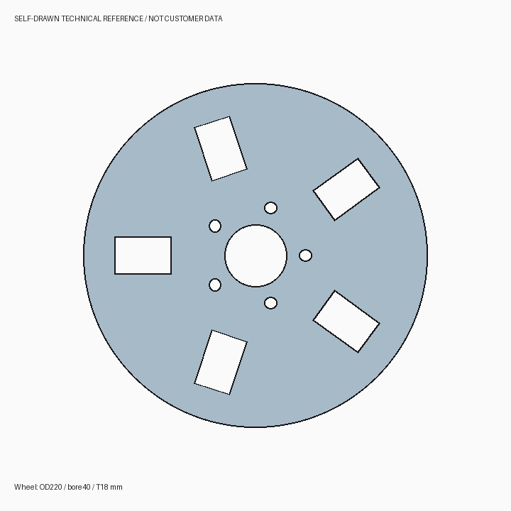
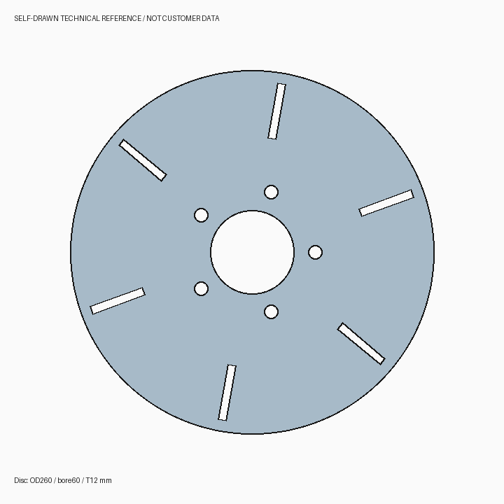

# PhyXiCATIAagent

**CATIA V5 自然语言原生建模插件 · OpenCode + MCP · 当前版本 0.6.5**

在插件中输入文字、粘贴图片或附加文件，使用 OpenCode 的连续会话与工具完成 CAD 辅助工作。核心能力是把自然语言需求转成 CATIA 原生 CATScript 宏，执行后保存、重新打开并核对实际结果。

## 功能

| 功能 | 说明 |
|---|---|
| OpenCode 图文对话 | 图片/文件上传、剪贴板图片、缩略图、连续会话、实际工具结果 |
| 同一会话互通 | 插件与本机 OpenCode 默认服务共享项目和 session；可从原生界面继续 |
| 模型 / Agent / 变体 | 动态读取 OpenCode 配置，不固定图文页模型 |
| 原生建模 | 生成专属 CATScript；调用 native-modeling MCP 自动执行、去重和结果核对 |
| 第二套 MCP | 可继承已配置的 [catia-v5-mcp-server](https://github.com/daiemon12/catia-v5-mcp-server) |
| 既有工具 | SimpleCADAPI 示例、密封槽、轮毂/制动盘、曲面与截面辅助分析 |
| 完整 OpenCode 功能 | “完整 OpenCode 界面”进入同一项目/会话，使用斜杠命令、终端、差异等原生交互 |

Tk 图文页展示文本与工具结果，完整原生交互由 OpenCode 入口提供。图片能否被正确理解取决于所选模型与服务；上传能力不会把纯文本模型变成视觉模型。

## 环境

- Windows x64；合法安装并可通过 Automation 调用的 CATIA V5。
- Python **3.12 x64** 推荐（源码部分使用 `Path.is_junction`，完整运行建议使用 3.12）。需包含 Tk。
- .NET Framework 4.x x64 编译器、Windows `tar`、联网下载依赖。
- 图文页已验证 **OpenCode Desktop / CLI 2.2.0** 的默认本机服务。其他版本的 API 兼容性需另行验证。
- SimpleCADAPI 2.2.1、MCP SDK 和 pywin32 等依赖见 [requirements.txt](requirements.txt)。

## 安装

从 [Releases](https://github.com/qlsupersky/PhyXiCATIAagent/releases) 下载 0.6.5 安装包并解压，运行 `install.bat`；也可从源码安装：

```powershell
git clone https://github.com/qlsupersky/PhyXiCATIAagent.git
cd PhyXiCATIAagent
.\install.ps1 -Python "C:\Path\To\Python312\python.exe" -Workspace "D:\CAD\PhyXiCATIAagent-workspace"
```

默认安装目录为 `%USERPROFILE%/Documents/PhyXiCATIAAgent/app`，默认工作目录为 `%USERPROFILE%/Documents/PhyXiCATIAAgent`。升级时保留已有配置；自定义工作目录请显式传入 `-Workspace`。

源码仓库不保存 200 MB 的 OpenCode 可执行文件。首次源码安装自动运行 [fetch-runtime.ps1](fetch-runtime.ps1)，下载固定版本的官方 npm 包并校验 SHA-256。Release 安装包已包含固定运行时。隔离宏生成引擎使用 OpenCode **2.0.20**，与图文页所连的 Desktop **2.2.0** 是不同组件，不能直接互换。

## 在 CATIA 中打开

1. 使用安装程序创建的“PhyXiCATIAAgent”开始菜单快捷方式，或工作目录中的“启动PhyXiCATIAAgent”。
2. 也可在 CATIA“工具 → 宏 → 宏”添加安装目录下的 `macros` 宏库，运行 `PhyXiCATIAAgent.CATScript`。
3. 在“OpenCode 图文对话”中点击“连接 / 刷新”，选择实际项目和会话。
4. 选择“添加图片 / 文件”或粘贴剪贴板图片，输入要求后发送。`Ctrl+Enter` 发送，`Ctrl+V` 粘贴图片。
5. 需要原生终端、斜杠命令等时，点击“完整 OpenCode 界面”继续同一会话。两个界面应等待当前轮完成后再提交下一轮。

模型服务、API Key 和权限沿用本机 OpenCode 配置。专用原生建模页的隔离引擎仍使用本机 DeepSeek 加密凭据；通用图文页不受其固定模型影响。仓库和安装包均不包含凭据。

## MCP 配置

将 [examples/opencode-mcp.example.json](examples/opencode-mcp.example.json) 中的占位路径替换为实际安装与工作目录，再把 `native-modeling` 条目合并到现有 OpenCode 配置。不要覆盖现有模型和凭据配置。`PHYXI_NATIVE_WORKSPACE` 与插件工作目录保持一致。

第二套 `catia-v5` 需独立部署。两套服务必须使用相同 `PHYXI_NATIVE_GATE` 数据库路径，才会共享 CATIA 执行互斥；独立上游服务不自动获得该包装层。[第二套 MCP 接入说明](docs/SECOND-MCP.md)。

## 示例

- “创建 100×60×12 mm 安装板，以原点为中心，在中心开直径 20 mm 通孔，保留原生草图、拉伸和切除。”
- “生成五孔制动盘原生建模宏，直径 320 mm、厚度 24 mm，并保存后重新打开检查。”
- 上传参考图后：“描述图中主要轮廓、孔洞和尺寸；区分图片可见信息与需要 CAD 测量的信息。”




## 验证

```powershell
$env:PHYXI_TEST_WORK = Join-Path $env:TEMP 'phyxi-offline-tests'
New-Item -ItemType Directory -Force $env:PHYXI_TEST_WORK | Out-Null
python -m unittest discover -s tests -p 'test_*.py' -v
```

0.6.5 已通过 55 项离线回归，以及实际图文输入、同一会话跨插件/CLI 续接、文件读写和两套 MCP 只读调用。完整检查范围见 [验证说明](docs/VALIDATION-0.6.5.md)。离线测试不需要派发 CATIA 调用；`tests/*_validation.py` 中部分历史脚本会操作真实 CAD，应单独阅读后使用。

新请求自动执行。保留工程互斥、输入完整性、原文件保护和结果核对；状态不明的 CAD 调用不会自动重放。图文请求超时后刷新原会话，不要重新发送同一操作。几何已知失败自动释放，明确显示失败及诊断，修正后使用新的请求标识。

## 文档与来源

- [图文对话说明](OPENCODE-LINK.md)
- [自然语言原生建模](NATIVE-MODELING.md)
- [自动执行语义](AUTOMATIC-EXECUTION.md)
- [第三方组件](LICENSE-NOTICE.md)
- [公开发布整理范围](docs/PUBLIC-SNAPSHOT.md)

本项目包含新实现的 CATIA 自动化适配代码，不包含原 SolidWorks 插件 DLL、客户模型、私有设计要求或本机运行记录。演示曲面和检查结果不构成汽车 A 级曲面认证。
