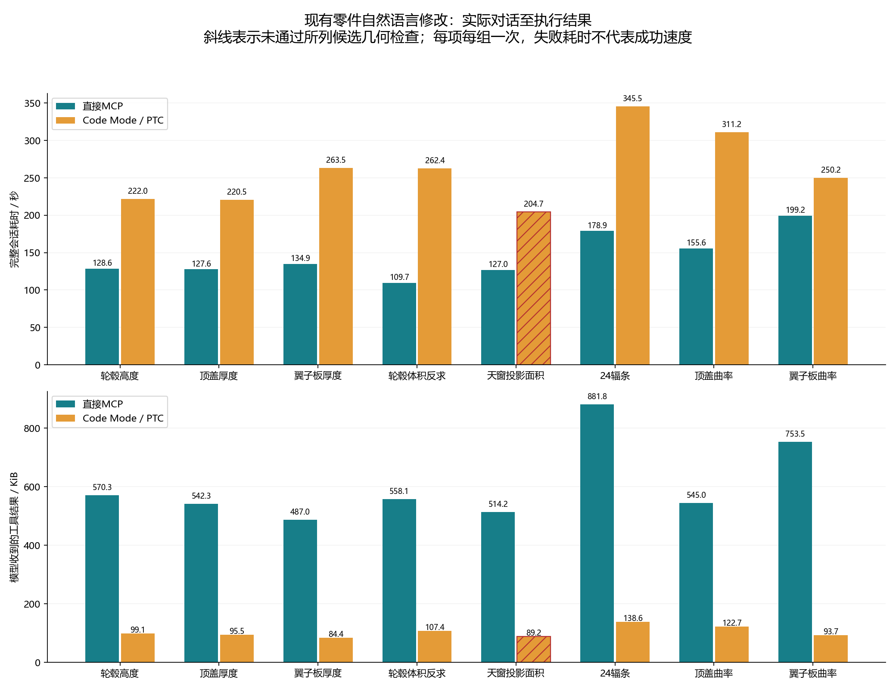

# 现有复杂零件自然语言修改：直接MCP与PTC对照

2026年11月14日。测试用户输入修改要求后，对已有轮毂、顶盖、翼子板执行参数发现、修改、保存重开与反馈。没有以新建整个Part替代编辑。两组真实gpt-6.1-sol/high，共同104项后端能力，直接组允许批量plan。实际入口为Codex app-server自然语言会话；生产0.7.0 WebUI/OpenCode未改为PTC、未做本轮端到端验收。

|任务|直接秒|PTC秒|直接候选几何/自主流程|PTC候选几何/自主流程|
|---|---:|---:|---|---|
|轮毂高度105→100|128.562|222.047|通过 / 完成|通过 / 完成|
|顶盖厚度2→3|127.625|220.515|通过 / 完成|通过 / 完成|
|翼子板厚度2→2.5|134.891|263.469|通过 / 完成|通过 / 未完成|
|体积+1%反求|109.734|262.437|通过 / 完成|通过 / 完成|
|天窗投影面积+25%|126.984|204.734|通过 / 完成|失败 / 未完成|
|20→24辐条|178.922|345.547|通过 / 完成|通过 / 完成|
|顶盖49点曲率修改|155.641|311.250|通过 / 完成|通过 / 未完成|
|翼子板49点曲率修改|199.156|250.203|通过 / 完成|通过 / 完成|

独立候选几何：直接8/8、PTC7/8；自主修改、自检与交付流程：直接8/8、PTC5/8。候选几何分数不把评测者补导STEP或收尾当成模型自主成功。

两组均自主完成的5项合计：直接743.999秒，PTC1300.749秒；PTC耗时为1.748倍。每项每组一次，只作工程诊断，不作统计保证。PTC压缩了回包，但本轮没有提速，供应方累计Token遥测也不能当成账单节省。

## 已确认的问题与优势

PTC能够用循环、公式和断言完成原参数比较、体积反求、49点坐标变换及24窗口编辑。轮毂阵列失败后自主改用24个闭合轮廓并通过所列检查，首次失败保留。直接调用同样可以批量执行，不能将其限制为低效逐动作基线。

天窗PTC把打开/绘制与关闭草图拆到两个程序，进程内句柄未延续，关闭前失败，最终仍为400×300。顶盖曲率PTC正确改了49点，但异常测距与不支持的限定名称查询中断自主验收；评测者仅留存失败现场、补导STEP并关闭文档。完整返回的两个特定失败各作一次取证登记，原始不确定记录保留，未重放、未更改通用错误策略。

翼子板厚度PTC因0.0002mm³重开舍入差超过自设0.0001mm³而误报，不能算几何错误。名称搜索取首项和未经实机核实的距离单位换算是测距排查方向，尚未确定唯一根因，也未宣称已修好。

六个匹配歧义会话均提出澄清且无几何/保存调用，源文件不变。另一个已知103mm错误候选接收真实截图和明确测量反馈，再修改既有Hub至100mm；这是独立辅助修正，不是从图片盲测尺寸差或首次任务成功率。

## 验证范围

原生参数与实际对话审计、保存重开、独立STEP有效单实体、指定孔轴/半径及通孔射线、开口四壁、窗口/材料辐条分布、指定插值点、厚度/周界及所选裁剪面局部曲率。8个未修改模型负对照均被正确拒绝。跨CATIA/OpenCascade的曲面体积积分差异仍单列保留。

这些演示件不具备A级、G1/G2或制造认证；不证明任意孔洞识别或所有工具可用。普通截图路径不代表模型看过像素。原始会话、模型、私有配置及凭据留在本地；公开内容仅方法、脱敏汇总与统计图。

[结构化脱敏结果](evaluations/20261114-summary.json) · [前轮复杂零件新建评测](EVALUATION-20261112.md)
