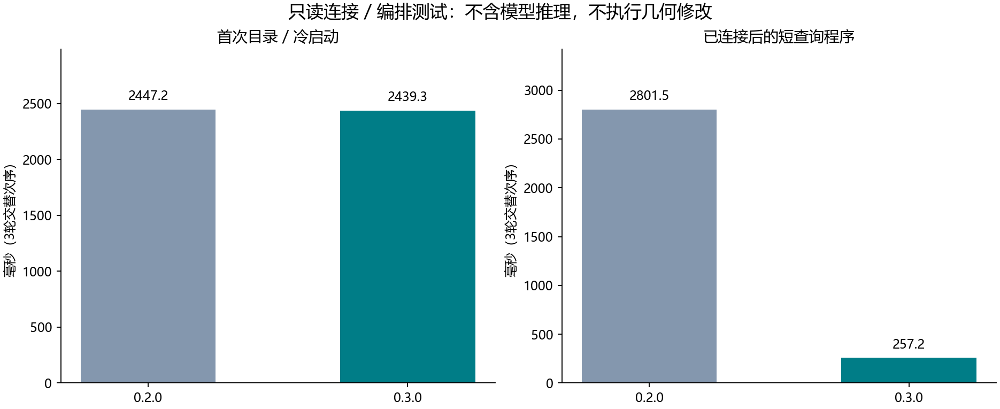

# Code Mode 0.3.0 优化与验证

日期：2026年11月16日。独立原因分析见 [CAUSES-20261116.md](CAUSES-20261116.md)。生产WebUI仍为0.7.0/OpenCode；本次修改独立CodeMode与建模Skill，不改变模型、provider或凭据。

## 已实施的改动

|改动|针对问题|实现及边界|
|---|---|---|
|后端会话及schema复用|R2草图句柄丢失、重复启动|每个facade生命周期只启动一次两套stdio后端；专属异步任务持有MCP上下文，调用排队串行。重启或另一个facade不保留句柄；不跨调用持有CAD锁|
|嵌套业务判错|枚举失败外层却成功|传播嵌套ok=false/失败状态，识别已观察的Could not enumerate faces/edges前缀；保留具体原因，Guest捕获后也不继续派发。没有修复上游枚举本身|
|显式数值容差|F1正常舍入被误判|新增cad.near，有限数校验，显式abs/rel，输出delta和limit；不自动改变工程目标，不默认替所有模型选择公差|
|执行入口有限等待|短任务反复轮询|ptc_execute默认异步等待最多20秒，wait_ms=0可立即返回；仍只有execute/status/catalog三个入口|
|建模工作流更新|重复读参、低价值测距|优先把草图生命周期放在同一program/plan，控制点参数一次读回后循环验证，仅返回差异。距离未经校准不得用于尺寸验收|

## 回归验证

- 40项CodeMode测试全部通过；另8项配置迁移回归通过；Skill格式校验通过。
- 测试覆盖真实QuickJS循环/分支/限制、同服务目录与多程序共享状态、上下文同任务退出、并发目录只启动一次后端、断连不重连/不重放、业务失败停止、合法空结果、显式容差正反例。
- 真实新Codex app-server确认3工具、0.3.0运行结果、默认等待返回终态、重复ID缓存不派发，以及已启用0.3.0 Skill。没有提交新的大模型自然语言推理轮次。
- 真实CATIA复杂顶盖回归：新副本中程序A创建500×300矩形，程序B关闭同一草图并完成400mm对称切除；保存、导出STEP、关闭重开通过。4个程序总计12.865秒（不含首次catalog、独立STEP检查及大模型推理）；不是与旧204.734秒自然语言任务的匹配速度基准。
- 独立OCP检查通过8项指定检查：单有效实体、指定孔轴/半径、500×300开口射线采样及4个精确平面边壁、4安装孔与周围材料、指定曲面插值点、原厚度、近边界曲面位置。原236项参数完全保留，包括147个XYZ；新切除增加15项参数。源文件SHA256未变。
- 同CATIA保存重开体积2135917.9811 mm³一致。独立OCP实体体积2119372.1815 mm³，仍有约0.78%差异，本轮未解决；不能用数值容差helper将其判作一致。

## 连接与编排效率

3轮交替旧/新次序，两者使用同一机器、两套真实后端及相同只读catia_plan_catalog输入；不调用几何操作、不运行模型推理。每个进程执行2次catalog和2个单调用QuickJS程序。旧版每次重起后端，新版首次连接后复用。样本很小，数字不代表所有CAD任务。

|指标|0.2.0中位数|0.3.0中位数|
|---|---:|---:|
|首次目录/冷启动|2447.201 ms|2439.273 ms|
|第二次目录|2530.549 ms|0.0094 ms|
|已连接后短查询程序（每版6样本）|2801.541 ms|257.202 ms|

短查询程序开销下降约90.8%，约10.89倍；首次冷启动没有实质改善。QuickJS仍逐程序启动，实际CAD、推理、图像和几何验证可能继续主导总耗时。不把结果宣称为完整任务加速或token费用下降。

## 仍未解决与验证限制

测距单位和名称唯一绑定未实机校准，W3阵列UpdateObject的唯一根因未确定，复杂曲面跨内核体积差仍存在。没有重新跑8项自然语言编辑，也没有把旧PTC 5/8自主交付成绩改写为新成绩；新增容差helper不保证模型一定正确选用。绑定截图反馈沿用已有机制，本轮未新增生产WebUI自动识图路由或自动修复策略。

只读核查曾因返回全部参数超过8192字节而被明确标为FAILED；保留原失败记录，改为新请求返回参数/特征数量后通过，没有重放任何CAD修改。这也说明输出压缩仍需要程序主动筛选。

0.3.0已选择性部署到独立目录，配置只改catia-code启动脚本路径，备份留在本机；旧连接不强制重启，新Codex会话读取新版。Skill通过原生plugin/install更新并在新客户端发现。生产0.7.0 WebUI未改变。最终仅本次自有顶盖结果留在CATIA中，当前共享门IDLE；未关闭其他用户文档。
