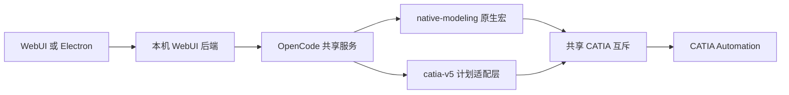
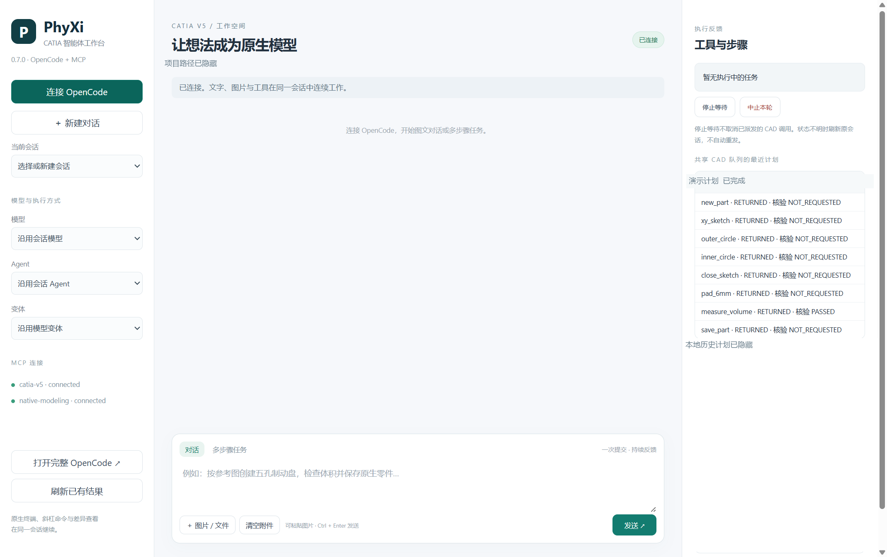
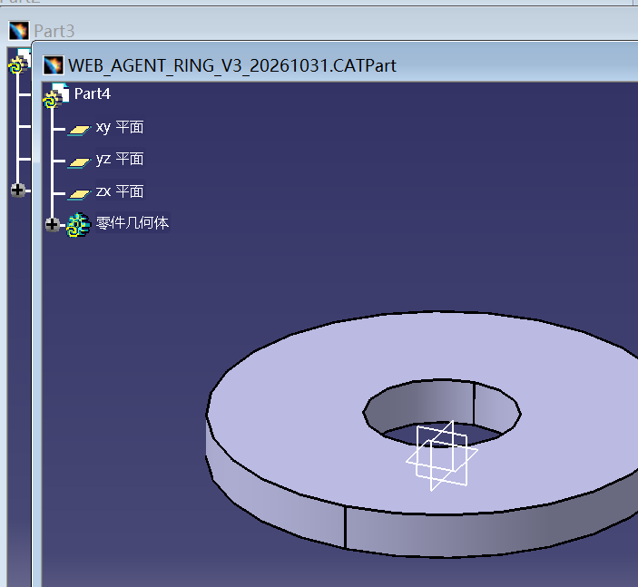

# 0.7.0 开发说明

开发完成于 2026-10-31，公开同步于 2026-11-02。本版为预发布版本。

## 实现内容

新增本机 WebUI 与 Electron 桌面壳，共用 OpenCode 连续图文会话，保留原有七页 Tk 插件、自然语言生成 CATScript 宏的核心流程以及完整 OpenCode 原生入口。支持文本、文件和剪贴板图片输入，动态读取模型、Agent 与变体目录。

多步骤模式将用户多个目标一次提交给真实模型；模型仍需选择实际工具和参数，界面不会把文字计划当作已经完成。第二套 MCP 新增 `catia_plan_run`、`catia_plan_status`、`catia_plan_catalog`，保留原工具共 101 个。

## 上游源码分析

分析对象为开源 CATIA-V5 MCP Server 0.2.2，提交 `ae47bbf6353cf16bda78e23640db6012de890471`，以及本项目插件；未取得或修改 CATIA 商业软件本体源码。

上游 `server.py` 将文档、草图、Part Design、GSD、装配、测量、工程图、导出与知识工程工具路由到单线程 STA，使用 asyncio shield 将取消等待与 COM 实际完成分开。`results.py` 提供结构化错误和 modified 未知状态，但较多正常反馈仍是字符串或 JSON 文本。

本版独立 `catia_adapter.py` 继承原分发机制，`plan_engine.py` 在外层增加持久计划、逐步事件和真实返回值检查。上游源码、原 98 个工具名称和输入 schema 保留，不在本项目捆绑上游部署。

## 工具执行与反馈

- 一份计划支持 1—30 个步骤，全量校验输入后开始，整份计划持有共享 CATIA 互斥。
- 唯一 request_id 与输入摘要绑定，重复请求只返回历史结果；输入改变需使用新标识。
- 每步开始、结束、原始返回、耗时、完成状态与显式检查写入 SQLite，首个失败后停止后续步骤。
- JSON pointer 检查实际值，支持比较与容差。缺值、类型错误或越界均失败。SUCCEEDED 只代表执行结束；声明检查通过不能替代整件几何验收。
- 明确绑定的同步 Automation 错误保留失败并释放入口；RPC、超时及不明执行不自动重放或解锁，不提供自动几何回滚。
- 工具目录默认简明返回，按名称取 schema；状态默认近期摘要，按 request_id 取完整记录，减少模型窗口截断。

## 实测与修复

真实 CATIA 11 步流程完成原生环形零件、体积检查、保存、关闭、重开与复测，体积 34557.5192 mm³。WebUI 一次图文任务正确读取受控图像，并完成 8 步圆环建模、测量和保存，体积 15079.6447 mm³，两项体积容差均为 ±0.1 mm³。

联调中修复 Windows 回执文件占用、CATIA SaveAs 的 Windows 路径分隔符、旧 MCP 进程复用及超长目录反馈问题。前两次 WebUI 保存失败保留原分类；重连加载修复后，以新请求通过。原始日志和真实会话留在本机，公开版本仅提供测试范围和汇总。

界面截图中的本机路径与请求标识已遮盖；本地历史计划区域隐藏。其余为实际安装界面。

该样件由图文智能体在 CATIA 中创建并保存，外半径 30 mm、内半径 10 mm、厚 6 mm。

## 范围与限制

本轮证明简单原生零件及工具流程可工作，没有重新完成翼子板、顶盖、轮毂和制动盘的全流程验收；86 项开发测试不代表 98 个工具均经真实几何验证。A级曲面连续性、任意 STEP 局部编辑及未修改区域核验仍需专项评测。

Electron 为外部桌面工作台，尚非 CAA 内嵌面板。发行包不含 Electron 和上游 MCP 运行库，需按 [使用说明](../WEBUI-070.md) 单独安装；本项目没有替用户安装 CATIA 或提供许可证。关闭前端不取消已派发的 CAD 工作。
