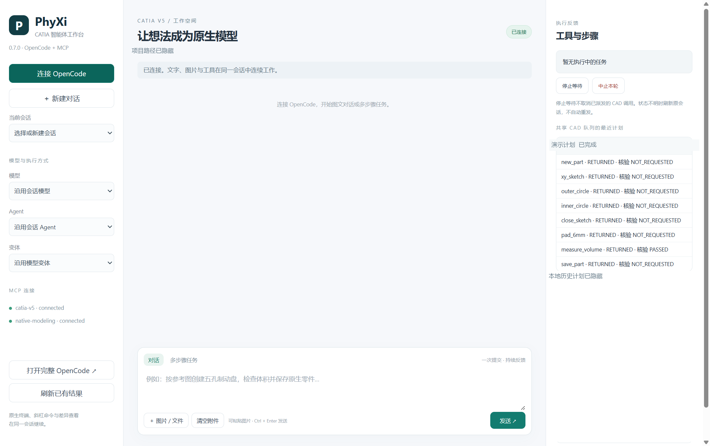
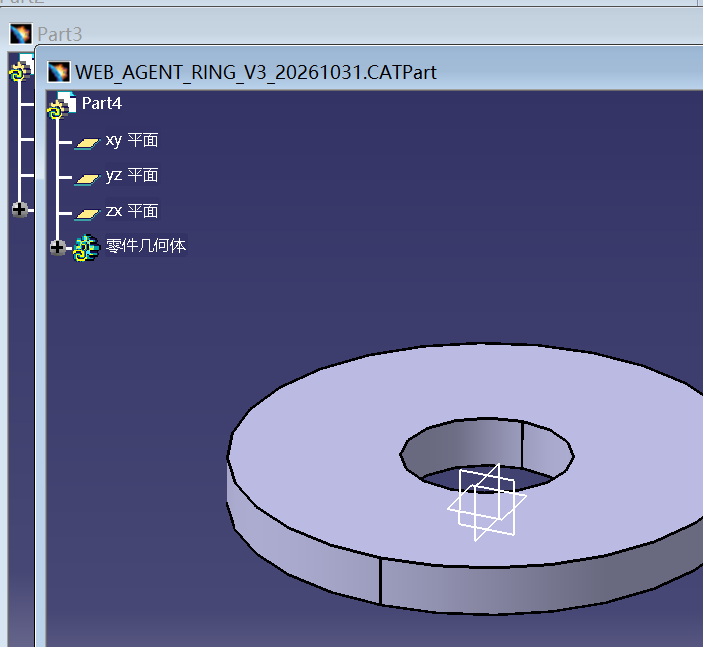

### 10月31日

公开整理于2026年11月2日，原始对话和本机运行证据留存本地，截图已去除本机路径与请求标识。

完成CATIA智能体插件0.7.0开发与本机安装，围绕WebUI、Electron、工具封装、智能体一次完成多个步骤及MCP信息反馈开展功能更新。分析开源CATIA-V5 MCP Server源码，在保留OpenCode＋MCP自然语言生成原生建模宏这一核心功能的基础上，新增图文工作台和多步骤工具计划，完成实际CATIA建模、测量、保存重开及图文联调，整理开发报告、实际对话、界面截图、测试数模和安装包。

1. 完成CATIA-V5 MCP源码分析与扩展方案设计
   1. 阅读开源catia-v5-mcp-server的服务分发、CATIA连接、文档、草图、零件设计、GSD曲面、测量及结果反馈等实现，明确其通过Automation接口调用CATIA的工作方式。
   2. 梳理原有98个工具及输入参数定义，确认COM调用通过单工作线程STA顺序执行，避免多个任务同时操作CATIA产生冲突。
   3. 分析原服务反馈特点：部分工具已有结构化错误信息，但较多正常结果仍以普通字符串或JSON文本返回，缺少跨工具的持久计划、逐步结果检查及统一进度反馈。
   4. 采用独立适配层扩展第二套MCP，保留上游源码、原工具名称及参数定义，将新功能接入插件现有OpenCode服务和共享CATIA执行队列。
   5. 明确本次分析对象为开源CATIA-V5 MCP及插件源码，未取得或修改CATIA商业软件本体源码；原有自然语言生成CATScript宏的核心流程继续保留。

2. 完成WebUI与Electron图文工作台开发
   1. 新增本地浏览器WebUI，提供连续会话、图片和文件上传、剪贴板图片粘贴、模型选择、Agent选择及模型变体选择等入口。
   2. 新增Electron桌面工作台，与WebUI共用后端和界面，保留原插件七个标签页，并在原界面顶部增加WebUI及Electron启动按钮。
   3. 复用OpenCode默认共享服务和真实session，保留同项目、同会话进入完整OpenCode原生界面的能力，继续使用终端、斜杠命令及其他原生交互。
   4. 新增“多步骤任务”模式，支持每行输入一个目标，一次提交后由智能体调用真实工具完成操作；前端文字计划不作为任务已执行的依据。
   5. 在界面右侧展示工具返回和共享CAD队列近期计划，包括执行步骤、返回状态、结果核验及未执行项目。
   6. WebUI仅在本机回环地址运行，页面不接收模型API Key；Electron关闭Node integration并启用上下文隔离和sandbox。
   7. 已安装版本实际打开Electron并连接两套MCP，读取24个模型及7个Agent的目录，未出现浏览器脚本错误；目录可读取不代表所有模型均完成能力测试。

图1：左侧显示会话、模型和MCP连接，中间为图文输入区域，右侧展示共享CAD队列的实际步骤及核验结果。原OpenCode完整界面仍可从左下方进入。

3. 完成多步骤工具封装与MCP反馈增强
   1. 在原98个工具基础上新增catia_plan_run、catia_plan_status及catia_plan_catalog，共提供101个工具，分别用于计划执行、状态查询和工具目录读取。
   2. 一份计划支持1～30个顺序步骤，执行前校验整份输入，执行过程中持续持有同一CATIA互斥，避免两套MCP交叉修改模型。
   3. 为每份计划记录唯一请求标识及输入摘要，相同请求重复提交时返回已有记录，不再次派发CAD操作；更改任务内容需使用新的请求标识。
   4. 将计划意图、逐步开始和结束事件、原始返回、状态码及实际耗时保存至本地SQLite，遇到首个失败后停止后续步骤，并标明未执行项目。
   5. 增加基于真实返回值的声明检查，支持数值比较及容差；缺少测量值、类型不符或超出容差均不能通过核验。
   6. 区分工具正常返回、声明检查通过和整件几何验收，避免将SUCCEEDED直接解释为零件质量全部合格。
   7. 状态查询不派发COM，可在长任务执行期间读取进度；工具目录默认返回简明信息，按名称读取具体参数定义，减少反馈过长导致模型上下文截断。
   8. 保留MCP原生图像及资源内容，增加适配器版本、进程号和加载时源码哈希反馈，用于核实实际运行的服务版本。

4. 完成真实CATIA多步骤建模与图文联调
   1. 直接MCP测试：一次调用完成11个步骤，包括新建零件、创建XY草图、绘制同心圆、关闭草图、拉伸、体积检查、保存、关闭、重新打开及再次测量。
   2. 11步样件实测体积为34557.5192 mm³，保存前和重开后的检查均在±0.1 mm³容差内；重复同一请求返回缓存，确认没有再次创建零件。
   3. 图文测试：在WebUI上传一张测试图片并一次发送任务，智能体正确回答3个红色圆形、蓝色矩形及底部英文标识SESSION-IMAGE-CHECK-7391。
   4. 同一轮任务中，智能体通过一次8步计划创建外半径30 mm、内半径10 mm、厚度6 mm的原生圆环，完成草图、拉伸、实际测量及CATPart保存。
   5. 8步样件实测体积为15079.6447 mm³，符合设定的±0.1 mm³容差，保存生成WEB_AGENT_RING_V3_20261031.CATPart。
   6. 同一会话继续使用OpenCode文件工具写入并回读测试标识WEB070-316，核对图文、建模工具和原有文件工具可在同一轮协作。
   7. 保留用户实际指令、智能体实际回复及逐步工具结果；最终图文任务未出现浏览器脚本错误，未把失败轮次计为通过。
   8. 本次图片测试验证图形和文字理解能力，不能据此认定复杂零件孔洞、曲面凹凸或A级质量识别已经通过验收。

实际图文对话和原始逐步记录保留本机，公开范围见[验证说明](../VALIDATION-0.7.0.md)。

图2：本次图文智能体生成的圆环样件，外半径30 mm、内半径10 mm、厚度6 mm。截图体现实际CATIA结果，尺寸与体积以工具记录核对。

5. 完成联调问题排查与执行状态修正
   1. 初次直接测试因客户端超时参数类型错误中断，保留失败记录；结合实际文档读回及CATIA正常退出证据协调状态后，使用新请求重新测试，11步流程通过。
   2. 排查WebUI高频轮询时的Windows文件替换占用问题，统一回执读写锁，并对本地证据文件替换增加短暂重试；不重发模型消息或CAD操作。
   3. 排查CATIA保存失败，确认本机SaveAs拒绝使用正斜杠的Windows路径，在MCP适配层增加路径规范化处理。
   4. 第二次WebUI测试发现OpenCode复用了旧MCP进程，未实际加载路径修复；在确认旧调用明确结束后断开并重连，第三次使用新请求完成保存。
   5. 对明确返回的Automation失败保留失败分类并自动释放执行队列；RPC、超时或执行结果不明时保留未确认状态，不依据进程消失或前端停止等待认定操作结束。
   6. 增加跨界面刷新后的提交回执核对，减少OpenCode任务已经完成、WebUI仍显示待刷新的情况，防止用户因界面状态滞后重复发送建模指令。
   7. 保留中断、保存失败、修复及重测的原始记录，没有将失败结果改写为成功，也未恢复人工审批弹窗。

6. 完成回归验证、本机安装与成果整理
   1. 完成82项离线测试及4项独立MCP适配契约测试，覆盖重复请求、参数校验、逐步检查、失败停止、状态恢复、图像保留及运行时异常等内容。
   2. 完成Python、JavaScript及PowerShell语法检查、桥接程序编译和已安装插件七页自检。
   3. 将0.7.0安装到现有插件目录，保留原工作目录、模型提供者配置及独立授权存储，新增Web和Desktop快捷方式及CATIA启动宏。
   4. 更新默认OpenCode项目与专用测试项目的增强MCP入口，保持两套MCP连接，并通过实际工具返回核对安装版本及源码哈希。
   5. 核对36个已安装Python模块与源码一致，WebUI及Electron文件一致；最终检查时共享CATIA执行队列为空闲状态。
   6. 整理开发与验证报告、使用说明、真实图文对话、四张截图、两份CATPart样件和验证记录，形成包含96个文件的0.7.0 Windows开发安装包，并完成SHA-256校验。
   7. 安装包不包含运行配置、API Key、真实用户会话及客户零件；Electron运行时未打入发行ZIP，新电脑需在安装目录运行install-desktop.ps1，本机运行时已就绪。
   8. 保留既有发布版本及历史证据，10月31日成果为本地0.7.0开发交付；已于11月2日根据后续指令同步GitHub预发布版。

7. 存在问题及待实现功能
   1. 本次实测以简单原生圆环为主，尚未在0.7.0中重新完成翼子板、顶盖、轮毂及制动盘的全流程几何验收；86项测试不代表98个原工具均已完成真实几何验证。
   2. 一次提交多个目标后仍依赖模型正确选择工具、映射参数和安排顺序，不能保证任意复杂自然语言要求均一次成功；需进一步测试长计划及复杂零件修改。
   3. 现有计划遇到失败会停止，但不提供自动几何回滚，已完成步骤可能留下部分模型；后续需研究可恢复的分段计划、诊断副本及修复流程。
   4. 需继续补充孔洞数量、孔径、位置、边界、曲面连续性及未修改区域等确定性检查，将几何核验结果接入统一反馈，减少仅凭模型文字判断成功。
   5. Electron当前为本地桌面工作台，通过宏或外部窗口启动，尚未实现CAA内嵌CATIA工作台；WebUI项目由启动配置指定，界面内项目切换仍待完善。
   6. 需进一步验证不同视觉模型、更多附件类型及复杂工具反馈的兼容性；目录中可选择模型，不等于该模型的识图与建模能力已经验证。

相关成果：[开发说明](../DEVELOPMENT-0.7.0.md)、[验证范围](../VALIDATION-0.7.0.md)、[使用说明](../../WEBUI-070.md)、[0.7.0预发布安装包](https://github.com/qlsupersky/PhyXiCATIAagent/releases/tag/v0.7.0)。
