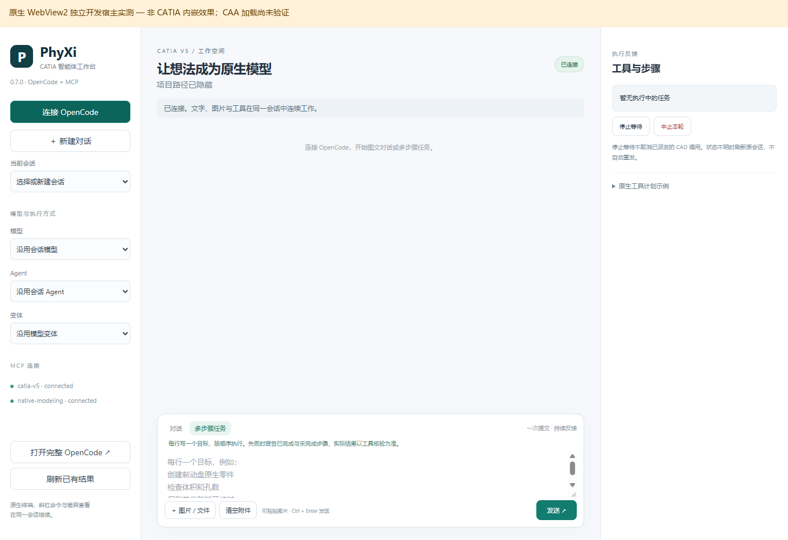

### 11月2日

完成CATIA智能体插件0.7.0成果的GitHub同步与预发布核验，开展CATIA内嵌工作台原型开发，完成原生WebView2宿主、CAA入口候选源码及独立界面测试。阅读CAA开发教程并核查本机安装介质，补齐VS2019生成工具、Windows SDK及ATL/MFC，完成实际编译运行验证。当前已具备经过验证的通用C++工具环境，仍缺匹配B33的CAA/RADE开发包，尚未完成CATIA内嵌模块的真实编译和加载。

1. 完成插件0.7.0成果同步与GitHub预发布
   1. 将WebUI、Electron、多步骤工具计划、原生建模与图文联通等已完成成果同步至公开仓库PhyXiCATIAagent，发布v0.7.0预发布版，保留原0.6.5版本及历史记录。
   2. 整理Windows安装ZIP及SHA-256校验文件，发行包包含101个文件，大小为93,085,668字节；安装包不包含凭据、客户零件、真实会话及运行缓存。
   3. 完成82项核心离线测试、4项独立MCP适配契约测试，以及语法检查、桥接编译、原界面七页自检和公开快照的WebUI、Electron启动检查。
   4. 核对GitHub附件与本地文件的哈希，完成仓库、源码、标签、预发布页面及附件的匿名访问与完整下载验证。
   5. 发布核验未新增CATIA几何测试；10月31日圆环建模、测量和保存重开的记录继续作为历史实测保留，不计为今天的新建模成果。

2. 完成CATIA内嵌工作台方案与原生宿主开发
   1. 设计CATIA通用工作区工具栏入口、原生命令及CATDlgDialog内部MDI面板，编写CAA Add-in、类工厂、字典和消息资源等候选源码。
   2. 实现原生WebView2宿主，在所属进程的UI STA线程创建WS_CHILD子控件，为后续接入CATIA内部面板准备界面基础。
   3. 宿主通过隐藏Python进程运行现有后端，并使用进程私有管道交接本地页面地址及令牌；不依赖宏启动界面或外部窗口重挂载。
   4. 继续复用现有OpenCode会话、图片输入、工具反馈及两套MCP，以自然语言生成原生建模宏作为插件核心能力；本次没有重新验证完整建模流程。
   5. 完成TDM-GCC与MSVC两种x64宿主构建。新增MSVC构建脚本，使用正式Windows SDK头文件及静态C++运行库，保留每次构建结果与校验记录。
   6. CAA入口仍为待编译候选源码；本机安装版保持0.7.0，未将实验原型包装成已完成的CATIA内嵌安装版。

图1：实际界面可连接OpenCode及两套MCP，支持图片附件和多步骤输入。图中为独立开发宿主，非CATIA内部运行效果，CAA加载尚未验证。

3. 完成独立宿主界面与生命周期验证
   1. 验证子窗口与宿主处于同一进程和同一UI线程，拒绝跨进程、跨线程挂载，并验证4种非法或外部地址被拒绝。
   2. 完成3次异步初始化期间立即关闭测试，以及正常关闭、窗口销毁检查；关闭界面不强制终止CATIA或重放已派发任务。
   3. 实际WebView2页面返回HTTP 200，后端版本为0.7.0；图片预览、附件清空、多步骤输入模式均通过，无浏览器脚本错误。
   4. 实际读取OpenCode的24个模型、7个Agent，两套MCP均显示connected；模型目录可读取不代表所有模型能力已验证。
   5. 完成3项环境预检自动测试，确认运行版不能被误判为完整SDK，前置文件存在也不能被写成已经完成CAA编译或授权验证。
   6. 本轮未发送大模型任务或CAD工具调用，未产生新的零件修改、孔洞识别、曲面理解或A级质量验收结论。

4. 完成CAA教程阅读与本机开发条件核查
   1. 阅读网页教程及《CATIA二次开发之CAA+RADE+VS安装配置全过程》文档，梳理开发工作区、前置依赖、mkmk构建、运行视图生成与CATIA启动流程。
   2. 确认本机运行环境为CATIA V5-6R2023 B33 SP4 x64；旧教程采用R19、Win32、VS2005等环境，不能直接作为B33的版本配置依据。
   3. 只读检查现有安装介质的3006个CAB、145833个文件成员，未发现所需CAA公开头文件、关键导入库及mkmk。
   4. 核实RADEInfrastructure资源包只包含相关资源与控制文件，不能将其认定为完整RADE开发工具。
   5. 核对官方Developer Guides、V5 Program Directory及下载入口，确认CAA介质与在线开发文档需要相应产品和Support访问条件；目前没有可用的开发介质或开发电脑。

5. 完成VS2019工具链补装与实际运行验证
   1. 使用微软签名有效的官方安装程序续装原有VS2019 Build Tools，补齐VC x86/x64工具、Windows SDK 19041、ATL及ATL/MFC。
   2. 前一轮安装返回取消，保留原始失败记录；随后继续补装成功，最终安装返回0，不覆盖或改写此前取消结果。
   3. 使用vswhere按四类所需组件共同核对，实例状态为isComplete=true、isLaunchable=true、isRebootRequired=false。
   4. 实际编译环境为MSVC 19.29.30159、Windows SDK 10.0.19041.0；完成x64 ATL/COM内存流写入，以及静态MFC初始化、CString与CMemFile读写测试，编译、链接、运行均通过。
   5. 核对实际头文件、x64库文件及哈希；提供x64开发命令行启动入口，仅配置子窗口环境，不修改系统全局PATH、HOME或CATICPath。
   6. 修正MSVC宿主构建脚本中哈希输出依赖问题，在新输出目录重新构建并完成独立宿主复测，保留首轮失败日志。
   7. 本次完成的是Visual Studio生成工具；完整IDE及CAA-RADE集成要求、B33官方支持的编译器与SDK组合，仍需依据匹配版本的正式资料核对。

6. 完成成果整理与后续交接
   1. 整理内嵌原型说明、宿主源码、CAA候选工程、构建和预检脚本、验证记录及标明“非CATIA”的实际截图。
   2. 整理VS补齐报告、最终安装状态、ATL/MFC实际测试记录，以及CAA/RADE获取申请模板，明确当前缺项和收到开发包后的操作顺序。
   3. 将已验证的通用源码与开发文档持续同步至GitHub，保留仓库历史，公开部分不含系统原始日志、账号材料、SDK、授权文件和客户数据。
   4. 更新项目进度记录，区分已完成的VS工具链准备、独立宿主验证与尚未完成的CAA编译加载，便于后续从当前状态继续。

7. 存在问题及待实现功能
   1. 仍缺匹配B33的CAA API开发介质、关键头文件、win_b64导入库及RADE构建工具；最新预检仍为BLOCKED_MISSING_CAA_DEVELOPMENT_ENVIRONMENT。
   2. 需要由学校、企业管理员、达索或开发合作方提供相应开发包与使用条件，或提供已有的匹配开发环境；VS补齐不能代替CAA/RADE。
   3. 取得开发环境后，需按实际SDK修正候选接口与资源绑定，完成编译、生成运行视图、独立CATIA环境配置及真实内嵌加载测试。
   4. 尚未完成Start菜单独立工作台、原生可停靠侧栏、CATIA内焦点与快捷键兼容、长期稳定性等验收。
   5. 后续还需在真正内嵌后验证图文输入、自然语言建模宏生成、MCP执行、保存重开及复杂零件修改；今天的环境与界面测试不能代替这些功能验收。

相关成果：[0.7.0预发布](https://github.com/qlsupersky/PhyXiCATIAagent/releases/tag/v0.7.0)、[内嵌原型说明](../../embedded/README.md)、[开发环境状态与获取清单](../../embedded/ENVIRONMENT-STATUS.md)。
