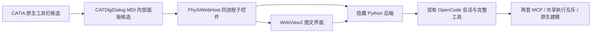
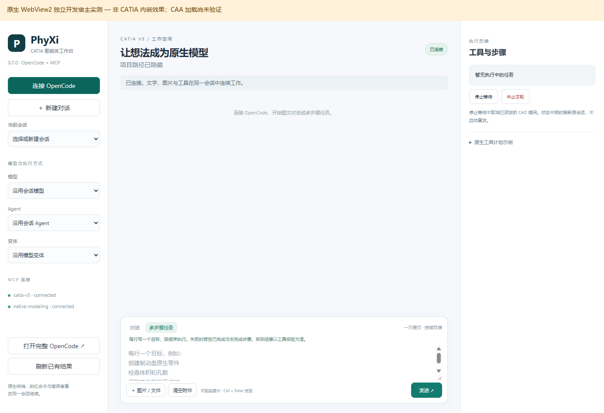

# CATIA 内嵌工作区原型（实验开发中）

**当前尚未在 CATIA 内完成加载验证，不能作为可用的 CAA 工作台安装。** 本机有 CATIA V5-6R2023 B33 SP4 运行环境，未找到匹配的 CAA 公开接口头文件、关键导入库及 mkmk。通用 MSVC x64 与 Windows SDK 已通过实际构建测试，但 B33 官方编译器兼容矩阵尚未确认。0.7.0 现有安装版和 Release 保持不变。

本目录实现了实际可编译运行的原生 WebView2 子控件宿主，以及待在匹配 SDK 下编译的 CAA 通用工作区工具栏/MDI 面板候选源码。入口设计为在 CATIA 内点击工具栏按钮，界面创建在 CNEXT 同一进程中的 MDI 子窗口里；不使用 CATScript 启动界面，不把 Electron 或浏览器外窗重挂到 CATIA。

已阅读用户提供的 CAA/RADE 环境搭建教程并核对本机版本，见 [教程核对记录](TUTORIAL-REVIEW.md)。其旧版 VS 对应表不能直接用作 B33 的配置依据。

**这一步是通用工作区 Add-in + 内部 MDI 面板原型，并未完成新的 Start 菜单独立工作台或可停靠侧栏。** CAA 对象生命周期、资源注册、MDI 焦点及版本兼容性均需在真实 SDK 编译和 CATIA 加载后验证。原生宿主测试窗口不是 CATIA，所有截图与结果明确标注其范围。



## 已验证与待验证

| 项目 | 本次结果 |
|---|---|
| 原生宿主编译 | TDM-GCC 10.3 与 MSVC 19.29.30159 x64 均编译成功；MSVC 使用 Windows SDK 10.0.19041.0；扁平 Windows C ABI 与 CAA 隔离 |
| 真正的子控件 | 在独立开发测试宿主中验证 WS_CHILD、同进程、同 UI STA；拒绝跨进程和跨线程挂载 |
| 后端启动 | 隐藏 Python 进程，进程私有管道交接本地地址和令牌，限定继承句柄 |
| 实际界面 | WebView2 内 HTTP 200，原有 0.7.0 页面、图像预览/清空、多步骤输入通过 |
| OpenCode 联通 | 当时读取 24 模型、7 Agent，两套 MCP connected；未发送模型请求或 CAD 调用 |
| 生命周期 | 三次创建后立即销毁、正常关闭和销毁窗口通过；异步回调持有安全状态，宿主模块固定加载 |
| 环境诊断 | 3 项自动测试通过；运行版不能冒充 CAA SDK，也不能把预检通过写成已经编译或加载 |
| CAA 模块编译与资源注册 | **未完成**：匹配开发环境缺失，候选源码未用真实 CAA 编译器验证 |
| CATIA 内显示/操作 | **未完成**：没有在 CNEXT 里加载本扩展，不能把独立测试截图当作 CATIA 效果 |
| 新的建模/修改几何验收 | 本次未进行，仍需在真正嵌入后逐项测试 |



## 源码

- `native/PhyXiWebHost.cpp`：WebView2 COM 异步初始化、隐藏后端、窗口焦点/尺寸/销毁、页面来源限制。启动失败不会重发模型或 CAD 请求。关闭只结束本界面的后端观察，不取消或解锁已派发 CAD 工作。
- `caa/PhyXiAgent`：通用工作区扩展、命令、CATIA MDI 子窗口、字典和消息资源。通过 `CATDialog::GetWindowHandle` 取得原生面板句柄；全部需在匹配 CAA SDK 下编译验证。
- `probe_environment.py` / `build-caa.ps1`：只读预检与显式 CAA 构建入口。失败即停止，不向 CATIA 运行目录复制未构建模块。
- `prepare-environment.ps1`：仅在编译/运行文件齐全后生成单独 CATIA 环境文件和本地 INI，不改全局安装环境。
- `tests/native_host_smoke.py`：开发测试宿主，标题明确 NOT CATIA，不作为产品启动器。

## 构建原生宿主

需 Windows x64、TDM-GCC/MinGW-w64 或 MSVC x64 开发环境，及另行安装的 WebView2 Evergreen Runtime。第三方 SDK 通过官方 NuGet 单独获取，不在 Git 中捆绑。

- 包：`Microsoft.Web.WebView2`，版本 `1.0.2903.40`
- 地址：`https://api.nuget.org/v3-flatcontainer/microsoft.web.webview2/1.0.2903.40/microsoft.web.webview2.1.0.2903.40.nupkg`
- 本次包 SHA-256：`ef128016dd1e51c59178c827ed5b8aa3322c57afa8675d930f8109505542ad74`

先核对 SDK 包哈希并解压，再运行：

```powershell
.\embedded\build-host.ps1 -WebViewSdk C:\Path\To\WebView2Sdk `
  -OutputDir C:\Path\To\NEW-native-output -Compiler g++
```

MSVC 构建时使用正式 Windows SDK 中的 EventToken.h；`native/compat/EventToken.h` 仅为已验证 MinGW 构建提供 ABI 值类型。CAA 模块必须使用与 CATIA/CAA 版本匹配的 MSVC/RADE，不能用 MinGW 替代 CAA 编译环境。

在 x64 MSVC Developer Command Prompt 中打开 PowerShell 后，可构建独立原生宿主：

```powershell
.\embedded\build-host-msvc.ps1 -WebViewSdk C:\Path\To\WebView2Sdk `
  -OutputDir C:\Path\To\NEW-msvc-native-output
```

脚本使用 `/MT`、真正的 Windows SDK 和 x64 官方 Loader，拒绝覆盖已有 DLL。已用 MSVC 19.29.30159 + Windows SDK 10.0.19041.0 完成 COM/x64 探针和宿主编译，并在独立开发宿主复测图片预览/清空、多步骤界面、生命周期和 OpenCode 两套 MCP 连接。未发送模型请求或 CAD 调用。**这只验证该原生宿主的工具链，不代表此组合已获 B33/CAA 官方认证，也不代表完整 VS 产品、ATL/MFC 或 CAA 开发环境已安装完成。**

CAA/RADE 的介质、接口库和兼容性资料应从对应产品的正式开发环境取得。参考 [Program Directories](https://www.3ds.com/support/documentation/program-directories)、[Developer Guides](https://www.3ds.com/support/documentation/developer-guides) 与 [软件入口](https://software.3ds.com/)。现有 CATIA 运行安装包中的 RADEInfrastructure 资源包不能作为完整 RADE SDK 使用。

## CAA 后续构建与部署

1. 安装并授权与 B33/SP4 兼容的 CAA-RADE、接口/导入库和受支持 MSVC 工具链。以匹配产品文档为准；本原型不提供或下载受限的 CAA SDK。
2. 在该开发环境中运行下面的预检。它只证明发现了部分前置条件，不证明 ABI 或授权有效。
3. 运行 `build-caa.ps1`。编译失败须保留日志并按实际 SDK 修正候选 API/资源绑定；成功后执行 mkrtv，确认模块、字典和消息资源实际生成。
4. 将编译好的原生宿主、WebView2Loader.dll 与完整 CAA 运行树放在单独扩展目录。使用 `prepare-environment.ps1` 生成独立环境，传入已安装 0.7.0 的 app 路径和原 workspace，保留现有 OpenCode 配置及凭据。
5. 工作保存且共享 CAD 队列空闲后，用 CATSTART 选择该环境正常启动 CATIA；在 CATIA 内启用 PhyXi Agent 工具栏并点击原生建模按钮。**此处是待实机验收流程，不是本次已成功的操作说明。**
6. 验证加载来源、内部窗口层级、文本/图片/焦点/缩放、关闭重开、两个 MCP、一次真实建模/保存/重开和未确认请求不重放后，才能发布内嵌安装版。

```powershell
python embedded/probe_environment.py --catia-root C:\Path\To\B33 `
  --sdk-root C:\Path\To\B33-CAA --output C:\Path\To\evidence\preflight.json

.\embedded\build-caa.ps1 -CatiaRoot C:\Path\To\B33 `
  -SdkRoot C:\Path\To\B33-CAA -EvidenceDirectory C:\Path\To\evidence
```

本地 INI 包含路径即可，不存放 Key。运行时凭据仍由原 OpenCode/插件授权存储处理。WebView2 profile 包含用户会话数据，禁止进入公开包。不要把编译日志、全局 CATEnv 文件或客户文件直接上传仓库。

## 验证方法与限制

```powershell
python -m unittest discover -s embedded/tests -p 'test_*.py' -v
python embedded/tests/native_host_smoke.py --dll C:\Path\To\PhyXiWebHost.dll `
  --app C:\Path\To\plugin-source --work C:\Path\To\NEW-test-work
```

开发 CDP 仅由测试宿主的显式 `--debug-port` 参数开启，产品 CAA 入口不设置该参数。不要将测试端口用于日常插件。测试当前未覆盖 B33 原生注册、CATIA 输入快捷键、A 级曲面几何操作或长期内存/崩溃稳定性。此原型保留既有执行互斥与未确认调用不重放规则，也不增加人工审核流程。

接口形态参考 CAA Dialog/ApplicationFrame 公开接口声明；本项目只提供自有适配源码，不分发 Dassault SDK、运行库或 CATIA 商业源码。WebView2 SDK/Loader 适用 Microsoft 包内许可，须保留第三方声明。
